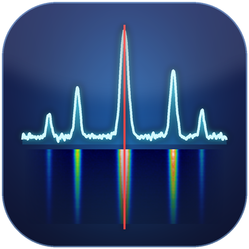
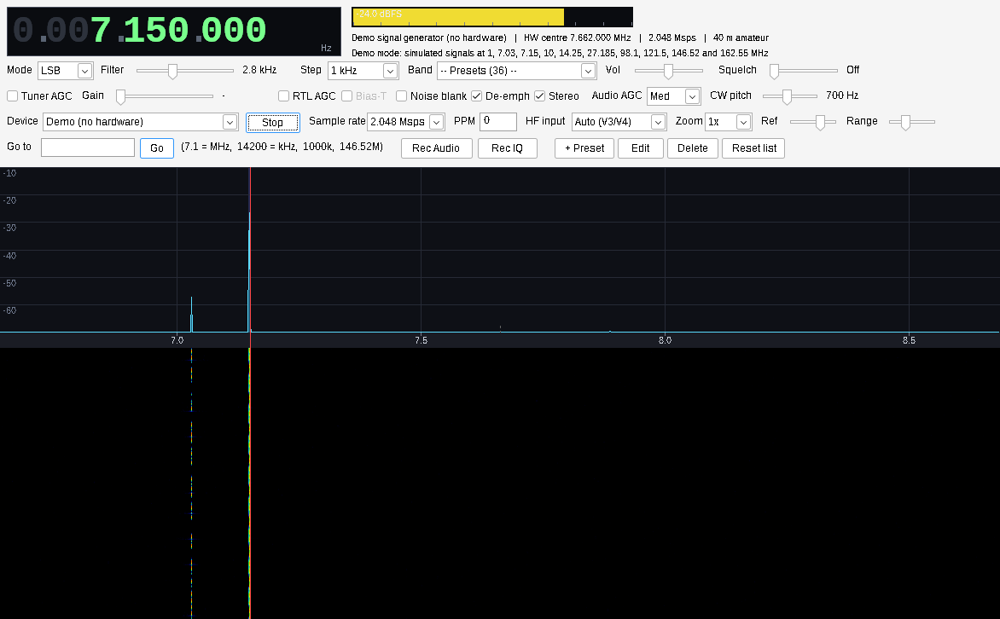
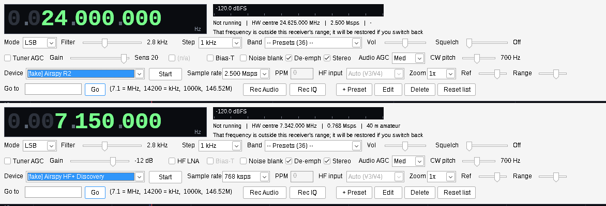
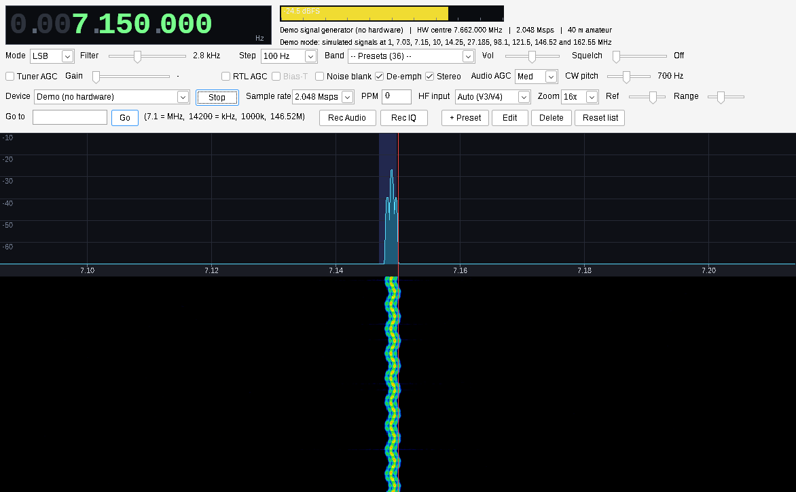
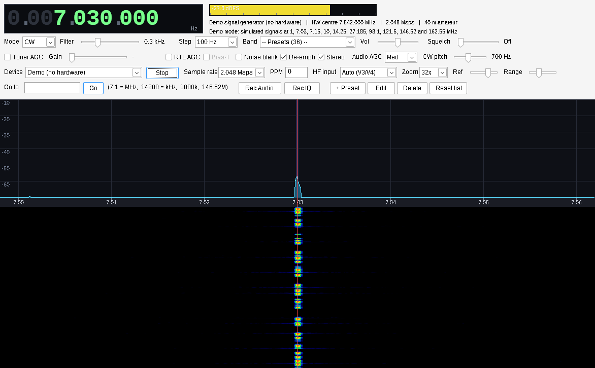
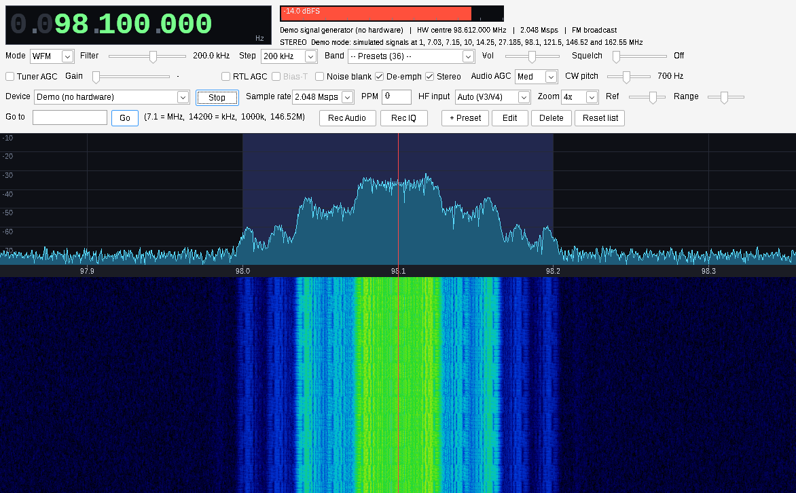
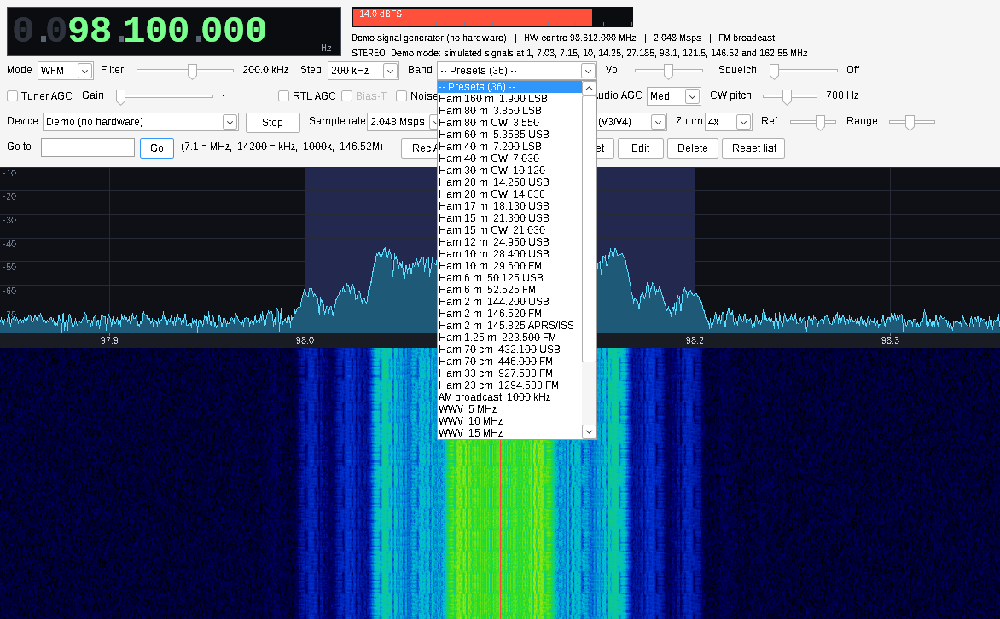
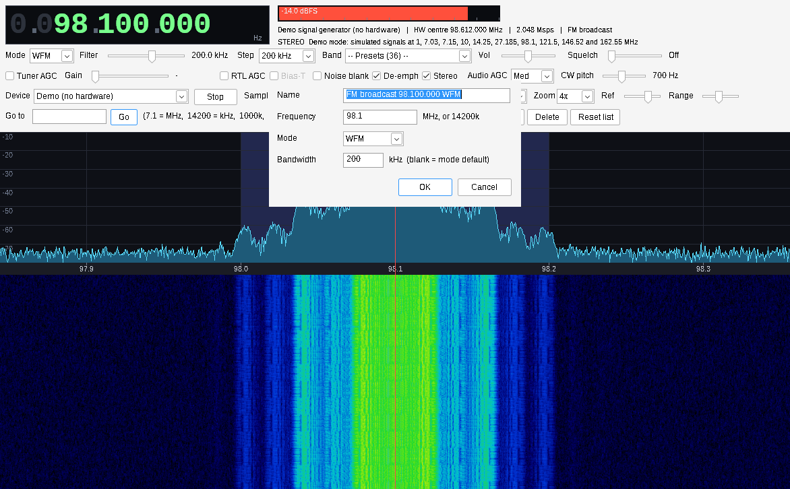

<p align="center"></p>

# TA-SDR

**A single-file Windows receiver for RTL-SDR, HackRF and Airspy.** No installer, no DLLs, no 400 MB runtime.
Just one `.exe` and the quiet confidence of a half-megabyte binary.

Hears everything your dongle can: **AM, SAM, USB, LSB, CW, NFM, WFM (stereo)**, from HF
to about 1.7 GHz. Ham bands 160 m through 23 cm are one dropdown away, so you can finally
find out what 40 m sounds like at 2 a.m. (Answer: other people who are also awake at 2 a.m.)


*Overview: a 2 MHz slice of 40 m. The keyed carrier on the left is CW; the wobbly one on the right is SSB.
(These are the built-in demo signals, because the author's antenna is currently a coat hanger.)*

## Supported hardware

| Receiver | Range | Rates | Gain controls | Status |
|---|---|---|---|---|
| **RTL-SDR** (generic, Blog V3 / V4) | ~24 MHz to 1.7 GHz; HF via direct sampling (V3) or upconverter (V4) | 0.25 to 3.2 Msps | Tuner gain, tuner AGC, RTL AGC, bias-T, PPM | Core target |
| **HackRF One** | 1 MHz to 6 GHz | 2 to 20 Msps | LNA + VGA (one slider), RF amp, bias-T | Implemented, untested on hardware |
| **Airspy R2 / Mini** | 24 MHz to 1.75 GHz | 2.5 / 3 / 6 / 10 Msps | Sensitivity gain, AGC, bias-T | Implemented, untested on hardware |
| **Airspy HF+ Discovery** | 9 kHz to 31 MHz, 60 to 260 MHz | 192 to 768 ksps | Attenuator, AGC, HF LNA | Implemented, untested on hardware |
| **Demo** | everything | up to 10 Msps | none needed | Fully tested; the stations are fake, the physics is not |

Devices are detected when you open the **Device** list, so plug in, click, go. The controls reshape
themselves to whatever you pick: sliders, labels and checkboxes that don't apply get greyed out
instead of lying to you.


*Same window, two receivers. (Captured with the developer test hook that conjures phantom devices,
since the author owns no Airspy and the photographer is not made of money.)*

Not yet supported: **SDRplay RSP**. Its API is proprietary and ships as a separate driver and service
that can't be bundled into a single `.exe`. It's doable (load it at runtime) but deserves its own release.

## Run it

1. Plug in the dongle. Run [Zadig](https://zadig.akeo.ie), pick the device's **Bulk-In, Interface**,
   install **WinUSB**. Once per device type. Windows insists. (HackRF and Airspy use WinUSB too.)
2. Grab `TA-SDR.exe` from [Releases](../../releases), run it, pick your device, press **Start**.

No dongle? Pick **Demo (no hardware)** for simulated stations on 40 m, 20 m, FM, airband and more.
It is the only SDR where propagation is always good.

## Tour

### SSB, zoomed in


Zoom up to 32x and the shaded **passband** shows exactly what your filter is listening to. Here it
hangs *below* the red tuning marker, because this is LSB, as 40 m has always been. Drag the **Filter**
slider to narrow it; the audio follows instantly.

### CW, readable by eye


Narrow filter (300 Hz here), adjustable **CW pitch**, and a waterfall sharp enough that you can read
the Morse before you hear it. That one says `CQ CQ DE W1AW K`. Go on, it's patient.

### Wideband FM, in stereo


Proper stereo decoding with a 19 kHz pilot PLL (the status line says **STEREO** when it locks; mono
stations fall back gracefully), de-emphasis, and a 200 kHz filter.

## Presets: yours to add, edit and delete



The **Band** list ships with ham bands 160 m to 23 cm (CW, SSB and FM calling frequencies), plus AM and
FM broadcast, WWV, CB, airband, marine, NOAA weather and more. Picking one sets the frequency, mode,
filter width and tuning step in one go.

It's *your* list, though:



| Button | Does |
|---|---|
| **+ Preset** | Saves what you're listening to right now (frequency, mode, filter width) under a name you choose |
| **Edit** | Changes the preset currently selected in the Band list |
| **Delete** | Removes it (asks first) |
| **Reset list** | Restores the built-in defaults (asks first, since this one is destructive) |

Presets live in `ta-sdr-presets.txt` next to the exe, one per line (`name|Hz|mode|bandwidth`), so you
can also edit them in Notepad, share them, or keep them in version control like a civilised person.

## Everything else

| | |
|---|---|
| **Tuning** | Click/drag the spectrum, mouse wheel on the spectrum (Ctrl = x10) or on any frequency digit, arrow keys, or the **Go to** box (`7.1` = MHz, `14200` = kHz, `1000k`, `146.52M`) |
| **Receive** | AM, SAM (PLL-locked, tracks +/-800 Hz of mistuning), USB, LSB, CW, NFM, WFM stereo |
| **Controls** | Filter width, CW pitch, squelch, audio AGC (off/fast/med/slow), noise blanker, de-emphasis, tuner gain / tuner AGC / RTL AGC, bias-T, PPM |
| **Range** | Whatever the dongle does, from 9 kHz to 6 GHz depending on the hardware. HF "just works" on RTL-SDR V3/V4 |
| **Record** | Audio to WAV, raw IQ in the device's native format (`.cu8`, `.cs8` or `.cf32`) into a `recordings` folder |
| **Accuracy** | Compensates for the R820T's coarse PLL, so your CW note stays where you put it |
| **Memory** | Remembers your settings between runs (`ta-sdr.ini`) |

## Build it

```sh
sudo apt install mingw-w64 git autoconf automake libtool make
./build.sh        # fetches libusb + librtlsdr, cross-compiles TA-SDR.exe
./build.sh test   # DSP self-test with synthetic signals, no radio required
```

CI does exactly this on every push, and attaches the `.exe` to a Release whenever a `v*` tag is pushed.
The icon is generated by `tools/make_icon.py`, because even the artwork is reproducible here.

## Honest disclaimer

Written and verified without a single dongle in the room: the DSP is tested against synthetic signals
(including HackRF/Airspy sample formats at up to 20 Msps, at about half a CPU core), and the GUI under Wine.
The RTL-SDR, HackRF and Airspy drivers compile, link and fail gracefully, but real-hardware and
real-speaker testing is up to you. If it misbehaves, open an
issue; "it sounds like a haunted dial-up modem" is a perfectly acceptable bug report.

## License

GPL-2.0, inherited from [librtlsdr](https://github.com/rtlsdrblog/rtl-sdr-blog) (patched slightly to
report PLL frequency error; see `patches/`). Also built in: libusb (LGPL), libhackrf, libairspy and
libairspyhf (all BSD-3-Clause). 73!
